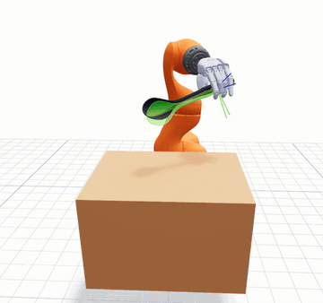
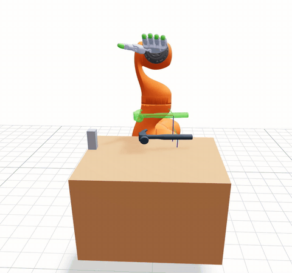
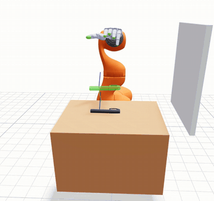
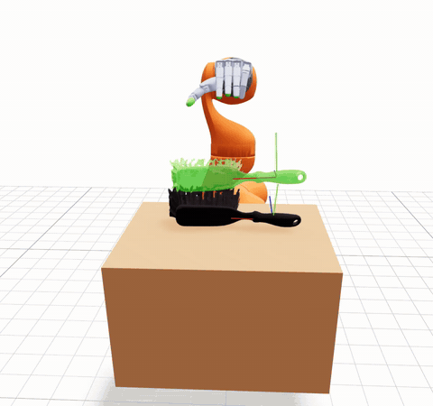

# Uni-simtoolreal

[English](README.md)

|  |  |
| --- | --- |
|  |  |

Uni-simtoolreal 在 UniLab 与 UniSim 上训练 SimToolReal teacher policy，使用 RL-Games SAPG；训练出的 checkpoint 可在 24 个随仓库提交的 DexToolBench 场景中评估。训练使用 KUKA iiwa14 机械臂与 SHARPA 手，覆盖确定性的 1,200 工具 MJCF 池。评估直接在 MuJoCo 中加载提交的静态场景。

## 范围

- **SimToolReal teacher 训练：** 24,576 个并行环境、6 个 RL-Games exploration block、完整 1,200 工具池。
- **DexToolBench 评估：** 全部 24 个 category/object/task 组合、Viser 交互检查、确定性 policy 回放。
- **固定运行时：** UniLab TorchEnv、UniSim MuJoCo、mjbatch VariantPack、SHA 锁定的 vendored RL-Games SAPG 运行时。

## 环境要求

- Linux x86_64
- 支持 CUDA 13.0 的 NVIDIA GPU
- [uv](https://docs.astral.sh/uv/)
- 依赖与生成资产约需 20 GB 可用磁盘

## 快速开始

```bash
uv sync
uv run simtoolreal-train
```

默认命令按完整生产规模训练。首次使用会生成 entity MJCF 工具池，并将训练进度写入 TensorBoard。

## DexToolBench

打开零动作交互查看器：

```bash
uv run simtoolreal-dextoolbench-interactive
```

使用训练 run 配置与 checkpoint 执行确定性 policy 评估：

```bash
uv run simtoolreal-dextoolbench-interactive \
  --run logs/rlgames_sapg/SimToolReal/<run> \
  --checkpoint last
```

Launcher 提供 upstream 的 category/object/task 选择器、Viser 控件、物体与目标渲染，以及评估生命周期。参见 [DexToolBench MuJoCo 评估](docs/dextoolbench-mujoco.md)。

## 验证

```bash
make check
make test
uv run simtoolreal-assets
```

完整验收还会使用默认命令训练到 RL-Games 保存持久 checkpoint，再让 DexToolBench policy 路径加载该 checkpoint。参见[验证](docs/verification.md)。

## 文档

- [架构](docs/architecture.md)
- [验证](docs/verification.md)
- [DexToolBench MuJoCo 评估](docs/dextoolbench-mujoco.md)
